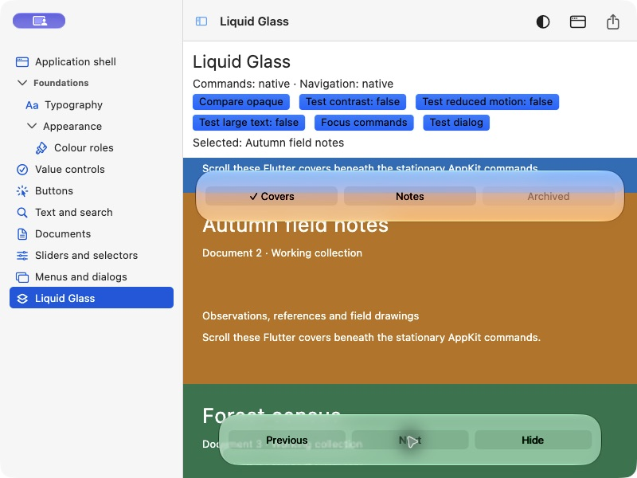

# macOS Liquid Glass Flutter UI

**0.9.0-dev.1 — pre-release for Flutter macOS applications.**

A `macos_ui` fork with native Liquid Glass command/navigation surfaces, semantic
Flutter controls and readable document layouts. It retains the familiar
`MacosApp`, `MacosTheme`, `MacosWindow`, `MacosScaffold`, `Sidebar` and `ToolBar`
APIs. Opaque accessibility/compatibility fallbacks and a labelled Flutter glass
approximation are included.



Native observation on macOS 27.2 arm64; not a deterministic Flutter golden or a
cross-platform certification. Native hosting is bounded command content, not
arbitrary Flutter children inside AppKit glass. See [composition](docs/liquid-glass.md).

## Install

Use this Git repository, not the upstream registry package:

```yaml
dependencies:
  macos_ui:
    git:
      url: https://github.com/jatatech/macos_liquid_glass_flutter_ui.git
      ref: main
```

Run `flutter pub get` and retain your app's lockfile. For a fixed dependency,
replace `main` with a reviewed commit SHA. Package publication to pub.dev is
currently disabled; this fork has its own pre-1.0 version sequence.

Import the public library:

```dart
import 'package:macos_ui/macos_ui.dart';
```

Follow [host setup and complete example](docs/developer-guide.md) for plugin/window
configuration. Native glass requires macOS 26+ and a suitable macOS SDK; only the
recorded macOS 27.2 arm64 runtime has been exercised. macOS 12 is the deployment
floor, not certified runtime support. [Support and limitations](docs/support.md)
distinguishes declarations, tested scope and open acceptance.

## Run the gallery

```sh
git clone https://github.com/jatatech/macos_liquid_glass_flutter_ui.git
cd macos_liquid_glass_flutter_ui
flutter pub get
cd example
flutter pub get
flutter run -d macos
```

Open **Liquid Glass**. Scroll covers, use native navigation/Next, switch to Notes,
and compare opaque rendering. The gallery also includes buttons, fields, menus,
settings and document filtering/sorting/inspection. Demo Save/Revert is session
state, not filesystem persistence. See [gallery instructions](example/README.md).

## Documentation

- [Developer guide and runnable consumer](docs/developer-guide.md)
- [Documentation map](docs/README.md) and [selected API dictionary](skills/flutter-macos-golden-gate/references/api-v1.md)
- [Glass composition, focus, overlays and fallbacks](docs/liquid-glass.md)
- [Migration from upstream](docs/migration.md)
- [Support, known limitations and outstanding acceptance](docs/support.md)
- [Optional consumer skill](skills/flutter-macos-golden-gate/SKILL.md) for assisted integration
- [Contributing and verification](CONTRIBUTING.md), [changelog](CHANGELOG.md)

This pre-release is usable within its documented scope. Full accessibility,
alternative-runtime/architecture, release-build and controlled performance
acceptance remain open. No multi-window or other-platform support is certified.

MIT licensed. [Source attribution](NOTICE.md). Independent of Apple and upstream
maintainers; no endorsement is implied.
