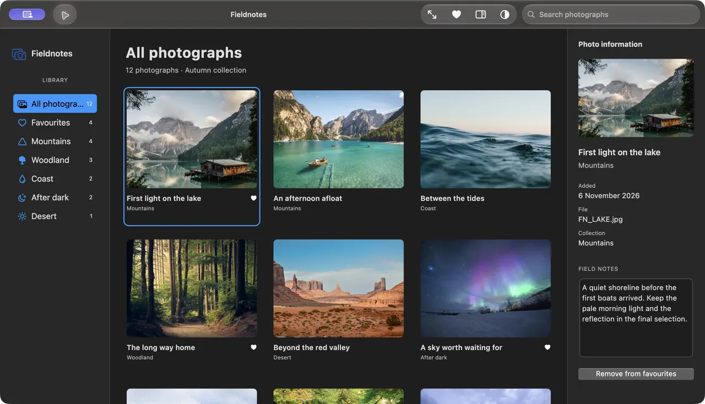

# macOS Liquid Glass Flutter UI

Native macOS glass, familiar Flutter widgets, and readable app content.
A `macos_ui` fork retaining `MacosApp`, `MacosWindow`, `Sidebar` and `ToolBar`,
with native AppKit toolbars, controlled search, coordinated panes and accessible fallbacks.



## Get started

```yaml
dependencies:
  macos_liquid_glass_ui:
    git:
      url: https://github.com/jatatech/macos_liquid_glass_flutter_ui.git
      ref: main
```

Import `package:macos_liquid_glass_ui/macos_liquid_glass_ui.dart`. Follow [Getting started](docs/developer-guide.md)
for macOS host setup and a complete first app. Pin a reviewed commit for reproducible builds.

## Explore

| Guide | What you will find |
|---|---|
| [Getting started](docs/developer-guide.md) | Installation, host configuration and public API choices |
| [Examples and components](docs/examples.md) | Animated app workflows, runnable source and component guides |
| [Glass and platform behaviour](docs/liquid-glass.md) | Native glass, Flutter approximation, composition and fallbacks |
| [Support and migration](docs/support.md) | Tested environments, limitations and [upgrading](docs/migration.md) |

**0.9.0-dev.1 · pre-release.** Native Liquid Glass requires macOS 26+; macOS 12 is
the deployment floor. Full accessibility,
other-runtime and performance acceptance remain open. [Details](docs/support.md).

MIT code license · [Photography credits](example/assets/fieldnotes/SOURCES.md) ·
[Attribution](NOTICE.md) · [Contributing](CONTRIBUTING.md) · [Changelog](CHANGELOG.md).
Independent of Apple and upstream maintainers. Available from Git; not on pub.dev.
