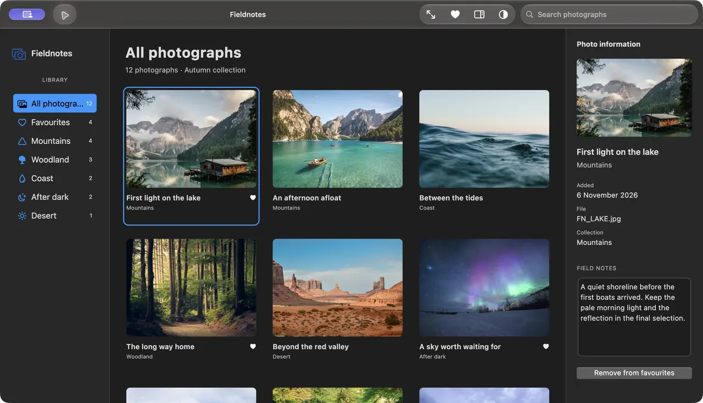
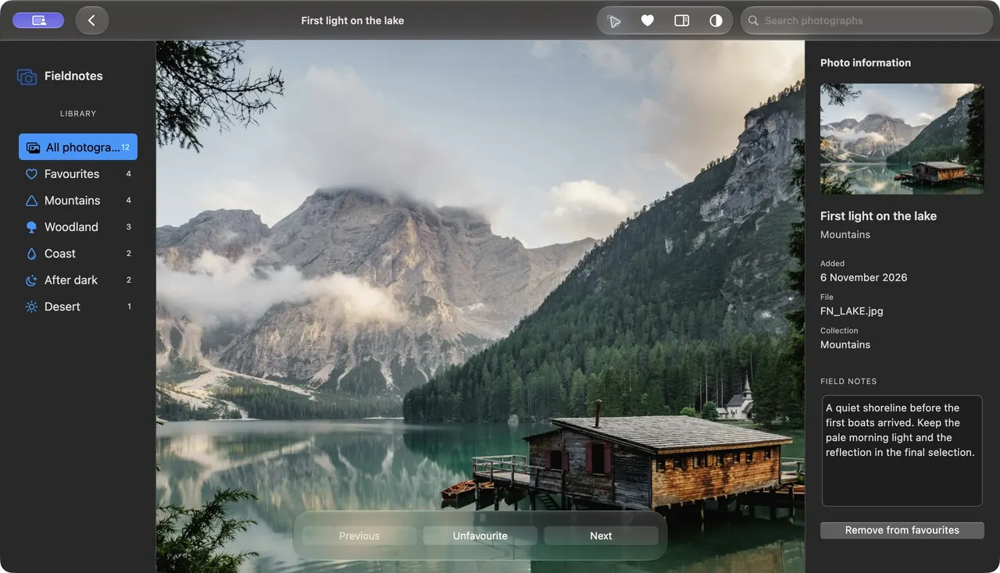

# Examples and components

## Fieldnotes: a photography workspace

A complete desktop example with twelve bundled landscape photographs, seven
library destinations, native search, favourites, editable field notes and a
selection-following inspector. Browse a collection, inspect a photograph, open
it, and return to the same search. Content stays readable; native glass belongs
to the command layer. All data and edits are local to the current app session.



[Still image](images/fieldnotes-library.jpg)

Clone the repository, run `flutter pub get` at its root, then:

```sh
cd example
flutter pub get
flutter run -d macos -t lib/showcase.dart
```

[Complete source](../example/lib/showcase.dart) ·
[Photo sources and license](../example/assets/fieldnotes/SOURCES.md)

Select an album or photograph. Use the native toolbar to search, open the
selected photograph, mark a favourite, toggle information or switch the app's
appearance. The inspector follows selection and retains notes by photograph.
⌘F finds photographs; app menus expose the same toolbar actions. Tab reaches
controls and Return/Space activate them. Search and notes keep standard editing menus.

## Viewing photographs with floating glass



[Still image](images/fieldnotes-viewer.jpg)

Open a selected photograph, then use Previous, Favourite and Next above the
image. Back returns to the filtered collection. The viewer combines the same
retained `MacosNativeToolbar` owner with a `MacosGlassCommandSurface`; its native
commands replace equivalent Flutter controls. It does not place Flutter children
inside an AppKit glass view. [Composition and ownership](liquid-glass.md).

## Smaller runnable examples

Run these commands from `example/` after resolving dependencies:

| Task | Command / source |
|---|---|
| First window, document table and settings | `flutter run -d macos -t lib/developer_example.dart` · [source](../example/lib/developer_example.dart) |
| Native toolbar, search, panes and staged dates | `flutter run -d macos -t lib/native_toolbar_example.dart` · [source](../example/lib/native_toolbar_example.dart) |
| Locale and directional shell | `flutter run -d macos -t lib/localization_example.dart` · [source](../example/lib/localization_example.dart) |
| Full component gallery | `flutter run -d macos` · [gallery guide](../example/README.md) |

## Component guides

| Build | Read |
|---|---|
| Native window commands, search and panes | [Native toolbar](native-window-toolbar.md), [task recipes](composition-recipes.md) |
| Application shell and navigation | [Foundations](shell-foundations.md), [sidebar and toolbar](shell-navigation.md) |
| Actions and controlled choices | [Buttons](foundational-buttons.md), [switches and segments](value-controls.md) |
| Text, search, dates and progress | [Fields](text-fields.md), [selectors](sliders-progress-selectors.md) |
| Collections and document content | [Tables](data-table.md), [lists/tabs](lists-tabs-scrollbars.md), [indicators](indicators-content.md) |
| Menus and temporary tasks | [Transient surfaces](transient-surfaces.md), [native dates](native-window-toolbar.md#stable-anchors-and-contextual-dates) |
| Semantic colors and localization | [Colors](semantic-colors.md), [locale policy](localization.md) |

Use public imports and inspect the actual constructors. [Support](support.md)
distinguishes native observations, automated checks and unverified environments.
